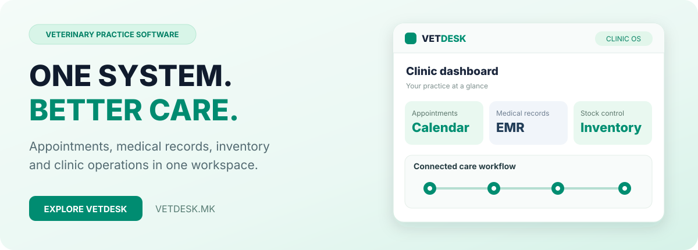

# VetDesk

[Македонски](README.mk.md) · [English](README.md) · [Shqip](README.sq.md) · [Türkçe](README.tr.md)

**Kujdesi veterinar dhe operacionet të lidhura.**

**LIVE**

## Softuer rreth punës reale veterinare

**VetDesk**, nga **PROCESS IN**, bashkon pacientët kafshë, pronarët, vizitat, takimet, inventarin, faturimin, rikujtimet dhe shërbimet për klientin. Mbështet vazhdimësinë e kujdesit dhe punën e klinikës.

Kujdesi, orari, kartelat dhe administrimi janë rrjedhë e lidhur për klinikën dhe ekipin mbështetës.

## Nga takimi te kujdesi

| Faza | Veprimi |
|---|---|
| 01 | Koordinoni disponueshmërinë dhe vizitën. |
| 02 | Lidhni kafshën me pronarin, historikun dhe të dhënat klinike. |
| 03 | Regjistroni vëzhgime, diagnoza, trajtime dhe shënime. |
| 04 | Koordinoni barna, materiale dhe laborator. |
| 05 | Organizoni kontekstin mjekësor dhe financiar. |
| 06 | Mbështesni rikujtimet, qasjen e pronarit dhe komunikimin ku aktivizohen. |

## Mundësitë

| Fusha | Përdorimi |
|---|---|
| **Pacientë dhe pronarë** | Profile, identitet dhe historik vizitash. |
| **Kalendari** | Planifikim i përditshëm i ekipit. |
| **Inventari** | Barna, materiale dhe regjistra stoku. |
| **Laboratori** | Gjetje dhe dokumente sipas moduleve. |
| **Faqja dhe rezervimi online** | Prani publike dhe rezervime sipas abonimit. |
| **Vendndodhjet dhe rolet** | Rrjedha dhe leje sipas lokacionit. |
| **Kartelat elektronike** | Shënime, diagnoza, trajtime, vaksina dhe dokumente. |
| **Rrjedha e vizitës** | Pranim, konsultim, trajtim dhe ndjekje. |
| **Fatura dhe mbyllje arke** | Administrim pagesash dhe arkë klinike. |
| **Portali i pronarit** | Qasje dhe komunikim sipas planit. |
| **Rikujtimet** | Kujdes i vazhdueshëm dhe vizita pasuese. |
| **Raportimi** | Pamje operative për mbikëqyrje dhe planifikim. |

## Kujdesi pas konsultimit

Rezervimet online, rikujtimet dhe portali lidhin punën me pronarin kur janë të aktivizuara. Inventari, laboratori, rezervimet dhe modulet e pronarit varen nga të drejtat e abonimit.

## Për kë është

Praktika të pavarura, klinika me disa veterinerë, ekipe që menaxhojnë kafshë e pronarë dhe klinika që kërkojnë rezervim e shërbime të integruara. Rrjedha lidh kontekstin klinik dhe operativ.

## Vlera e integrimit

Takimi dhe shënimet qëndrojnë në kontekstin e pacientit; historiku dhe vizitat organizohen së bashku; administrimi lidhet me modulet dhe raportet; komunikimi me pronarin bëhet më i qartë. Struktura i shërben punës klinike, në vend të mjeteve të përgjithshme.

## Terminologjia

Menaxhim veterinar, EMR, kartela kafshësh, portal pronari, takime, inventar, faturim, rezervime online dhe punë në shumë lokacione përshkruajnë fushën, jo integrime të pakonfirmuara ose veçori universale të çdo plani.

## Informacion për produktin

| Hollësia | Vlera |
|---|---|
| Produkti | VetDesk |
| Faqja zyrtare | [vetdesk.mk](https://vetdesk.mk) |
| Kategoria | SaaS menaxhimi për klinika veterinare |
| Statusi | LIVE |
| Zhvilluesi | [PROCESS IN](https://processin.mk) |
| Portofoli | [PROCESS IN](https://github.com/stambolce/process-in) |

### [Vizitoni VetDesk](https://vetdesk.mk)

Prezantim publik. Pa kod privat ose të dhëna pacientësh, pronarësh ose klientësh. Nuk jepet licencë me burim të hapur. Veçoritë, gjuhët dhe kushtet varen nga oferta aktuale.

---

This platform is a digital product of <a href="https://processin.mk" target="_blank" >PROCESS IN </a>· Your Enterprise Software & AI Partner ·  Hosted on Enterprise Infrastructure by <a href="https://inhost.mk" target="_blank">INHOST</a>·
